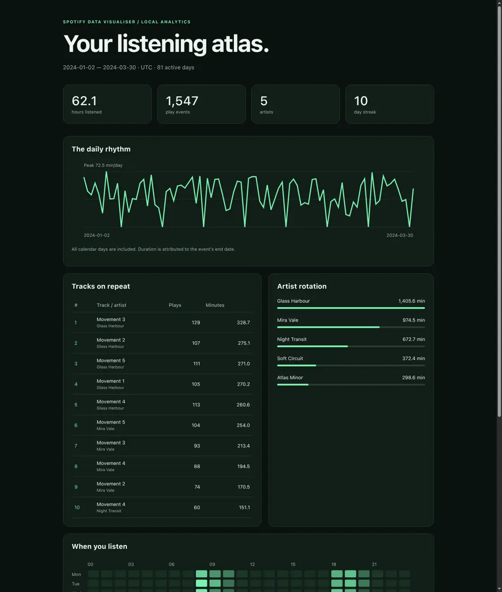
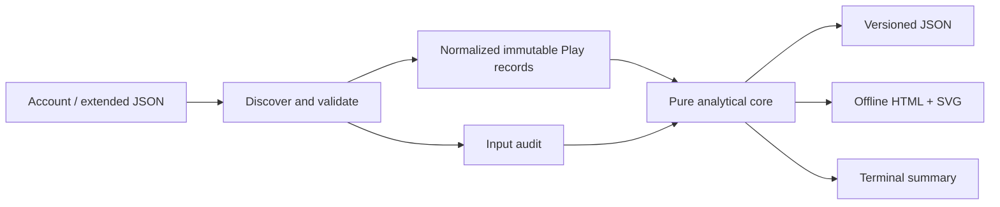

# Spotify Data Visualiser

An offline analytics pipeline that turns Spotify account and extended streaming exports into reproducible listening reports. Built in Python 3.11+ with **zero runtime dependencies**.

The project demonstrates schema normalization, explicit data-quality accounting, timezone-aware temporal analysis, information-theoretic metrics, and deterministic reporting. The analytical core is independent of the CLI and presentation layer.

## Try it with fictional data

```bash
git clone https://github.com/gurv1r/spotify-data-visualiser.git
cd spotify-data-visualiser
python examples/generate_demo.py
python -m spotify_visualiser reports/demo-input.json --format html --output reports/demo.html
```

Open `reports/demo.html` in a browser. It is a standalone report with inline SVG charts: daily activity, artist rotation, track rankings, and a weekday/hour heatmap. No server, JavaScript, account connection, external assets, or network access is needed to generate or view it.



The seeded generator creates fictional artists and plays across 90 days. It can be rerun to reproduce the same input. Real exports and generated reports are ignored by Git in `data/` and `reports/`.

## Analyse your export

Request your listening history from [Spotify account privacy settings](https://www.spotify.com/account/privacy/), then extract the JSON files into `data/`. Both common export layouts are accepted:

| Export | Recognized fields | Directory discovery |
| --- | --- | --- |
| Account history | `endTime`, `msPlayed`, `trackName`, `artistName` | `StreamingHistory*.json` |
| Extended history | `ts`, `ms_played`, `master_metadata_*`, optional `spotify_track_uri` | `Streaming_History*.json` |

You can also pass JSON files with arbitrary names explicitly. Directories are searched recursively; unrelated JSON files are excluded.

```bash
# Human-readable summary
python -m spotify_visualiser data/

# Date filters use the selected local timezone and include both endpoints
python -m spotify_visualiser data/ --timezone Europe/London \
  --start 2024-01-01 --end 2024-12-31 --min-ms 30000 \
  --format html --output reports/2024.html

# Machine-readable output; audit messages go to stderr
python -m spotify_visualiser data/ --deduplicate --format json > reports/listening.json

# Fail fast rather than skipping malformed music rows
python -m spotify_visualiser data/ --strict --top 20
```

`reports/` is created by the demo or by `--output`; create it first if using shell redirection. `python total.py` remains a compatibility entry point, with the same CLI options. Use `--help` for the full interface.

Optional installation provides the `spotify-viz` command:

```bash
python -m venv .venv
source .venv/bin/activate
python -m pip install .
spotify-viz data/ --format html --output reports/listening.html
```

## Analysis and correctness

- **Track identity:** `(title, artist)` prevents unrelated artists' identically named tracks from merging. Releases with the same title and artist are deliberately combined across export formats.
- **Time series:** chronological daily totals, zero-filled inactive days, active-day counts, longest listening streak, and a timezone-aware 7 × 24 activity matrix.
- **Sessions:** sort inferred playback intervals and start a new session when the idle gap exceeds `--session-gap` minutes (default 30). Long tracks and overlapping intervals do not create false breaks.
- **Diversity:** Shannon entropy of artist play counts, `H = −Σ pᵢ log₂ pᵢ`; effective artists `2ᴴ`. Equal play counts for four artists yield four effective artists. Top-artist share separately measures concentration by listening duration.
- **Input audit:** each row is accounted for as accepted, invalid, non-music, or a removed duplicate. Counts describe ingestion before report filters. Up to five error examples include source filenames and row numbers.
- **Reproducibility:** stable file discovery, deterministic leaderboard tie-breaking, versioned JSON output, integer millisecond accumulation, explicit parameters, and no generated timestamps.

Empty datasets, zero durations, and one-day histories produce valid reports. Bad JSON and missing files fail explicitly. `--strict` fails on malformed music rows; otherwise they are skipped with diagnostics. Extended rows with null track metadata are excluded as non-music/unavailable track data. Output cannot overwrite an input file.

## Architecture



| Module | Responsibility |
| --- | --- |
| `ingest.py` | File discovery, schema adapters, validation, optional exact deduplication |
| `models.py` | Immutable slotted play records and ingestion audit |
| `analytics.py` | Filtering, aggregations, streaks, diversity, sessionization |
| `report.py` | Escaped HTML/SVG and deterministic JSON serialization |
| `cli.py` | Arguments, orchestration, output, exit codes |

See [engineering decisions and limitations](docs/engineering.md) for complexity, temporal assumptions, and tradeoffs.

## Development

```bash
python -m unittest discover -s tests -v
python -m pip install -r requirements-dev.txt
ruff check .
ruff format --check .
mypy spotify_visualiser
```

The suite includes mixed-schema normalization, corrupt input, exact deduplication, DST's repeated hour, inclusive date filters, overlapping playback intervals, output overwrite protection, HTML injection prevention, and randomized conservation of duration across every aggregation. CI runs tests and a packaged CLI smoke test on Python 3.11–3.14, plus Ruff and strict mypy checks.

To measure the analytical core on synthetic records:

```bash
python -m benchmarks.run --events 100000
```

It reports wall time and traced Python allocation peak. Input generation is excluded; parsing and report rendering are not measured. Results depend on the machine and tracing overhead. No performance claims are inferred from unmeasured datasets.

## Assumptions and scope

A play is an export event, not a Spotify-qualified stream. Timezone-naive account timestamps are assumed UTC; `--timezone` changes reporting buckets, not that input assumption. Each event's entire duration is attributed to its ending date/hour. Missing metadata cannot establish whether a null record was a podcast, unavailable track, or another content type. Sessions are estimates and simultaneous activity may double-count time. Exact deduplication is opt-in because identical rows may be legitimate events; rows with differing URI metadata are not exact duplicates.

History is held in memory and sorted; this is not a streaming database. Reports contain listening metadata and should be shared deliberately. No genre, audio-feature, or recommendation claims are made because exported histories do not provide those features.

Licensed under [GNU GPL v3](LICENSE).
